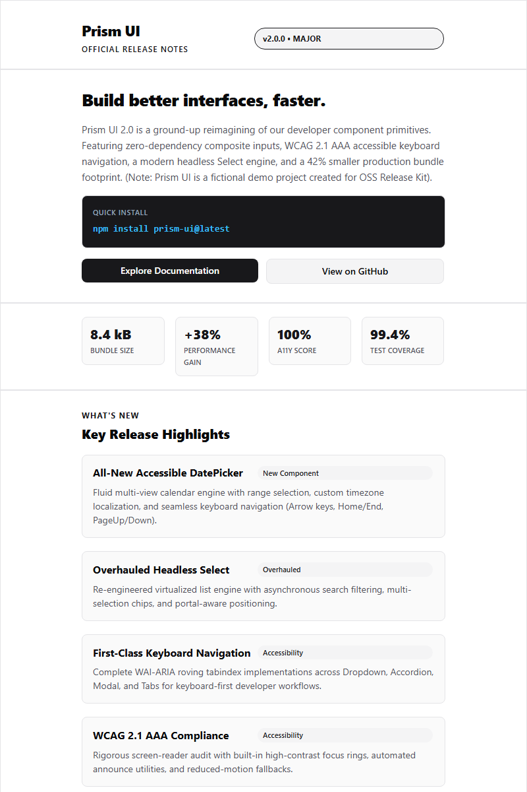
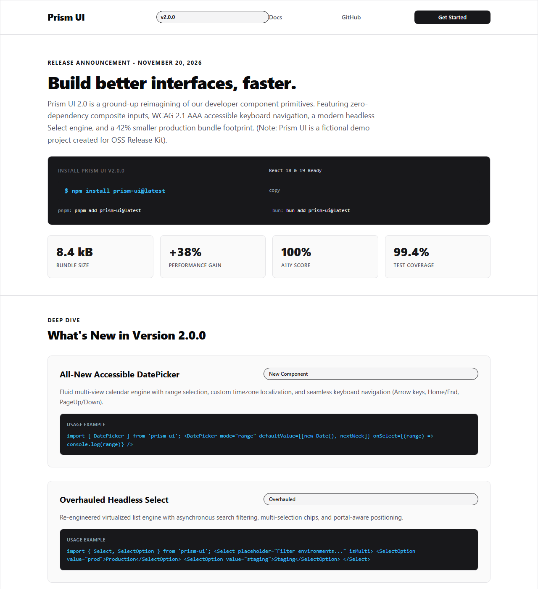
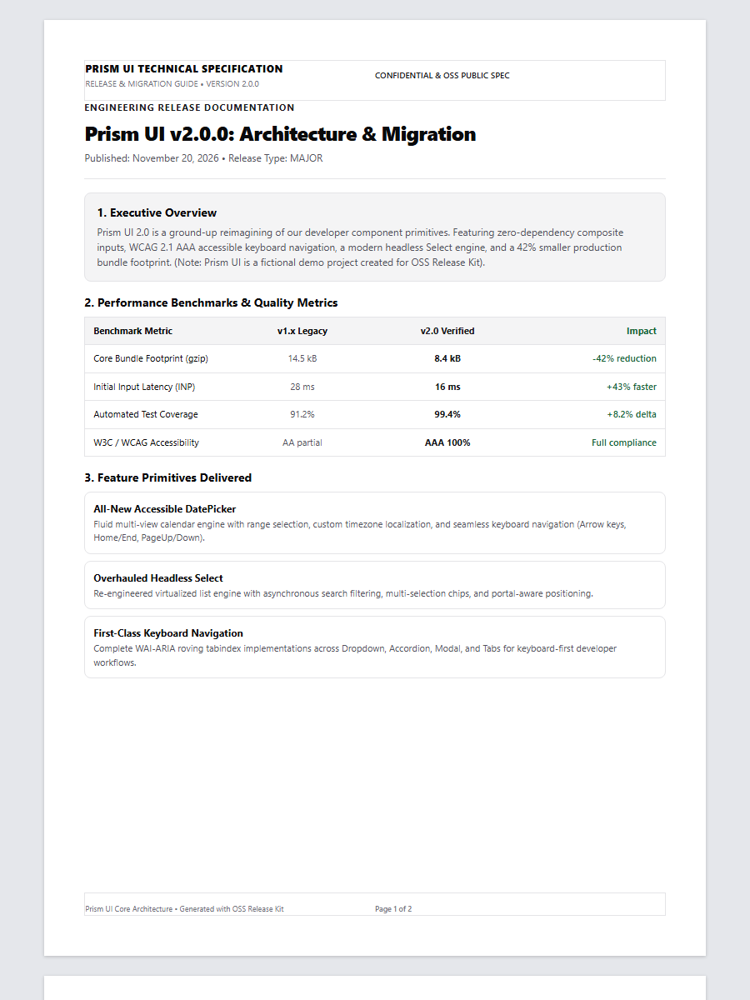
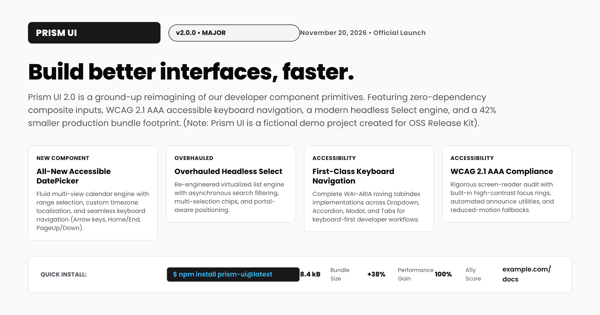

# OSS Release Kit

> **Write once. Publish everywhere.**
>
> A developer-focused content generation engine and studio built with **React**, **Next.js**, **TypeScript**, **Tailwind CSS**, and **Hyper Elements (`@hyper-elements/react`)**. Turn a single, canonical release definition into four professional deliverables:
>
> 1. 📧 **Release Announcement Email** (`<Email>`)
> 2. 🌐 **Developer Release Web Page** (`<Page>`)
> 3. 📄 **PDF Release & Migration Guide** (`<Document>`)
> 4. 🎨 **Social Media Launch Graphic** (`<Canvas>`)

---

## Architecture Overview

```
OSS Release Kit
├── AGENTS.md                               # Enforced Hyper Elements guidelines & quality checklist
├── outputs/                                # Real pre-rendered deliverable outputs
│   ├── prism-ui-v2.0.0-email.html          # Email HTML output (<Email>)
│   ├── prism-ui-v2.0.0-page.html           # Developer Release Page HTML (<Page>)
│   ├── prism-ui-v2.0.0-guide.pdf           # 2-Page Technical Migration PDF (<Document>)
│   ├── prism-ui-v2.0.0-guide-print.html    # Print-ready Document HTML
│   ├── prism-ui-v2.0.0-social.png          # 2400x1260 High-Res Canvas Image (<Canvas>)
│   ├── screenshot-email.png                # Rendered Email screenshot
│   ├── screenshot-page.png                 # Rendered Web Page screenshot
│   ├── screenshot-document.png             # Rendered PDF Guide screenshot
│   └── validation-report.json              # Hyper Elements CLI validation audit
├── src/
│   ├── app/                                # Next.js App Router (Studio UI & API)
│   │   ├── api/render/route.ts             # Dynamic server-side rendering & download endpoints
│   │   ├── layout.tsx                      # Root developer studio layout
│   │   ├── page.tsx                        # Developer Studio Dashboard
│   │   └── globals.css                     # Minimal developer styling & dark mode tokens
│   ├── components/
│   │   ├── editor/                         # Live Release & Brand customization forms
│   │   │   ├── ReleaseDetailsForm.tsx
│   │   │   ├── FeaturesForm.tsx
│   │   │   ├── BreakingChangesForm.tsx
│   │   │   └── BrandThemeForm.tsx
│   │   └── preview/
│   │       └── LivePreviewPane.tsx         # Multi-format switcher, viewports, outline inspector
│   ├── data/
│   │   ├── release.ts                      # Canonical ReleaseData TypeScript schema
│   │   └── defaultRelease.ts               # Prism UI v2.0.0 demo dataset (fictional library)
│   ├── theme/
│   │   └── brand.ts                        # Unified BrandTheme design tokens
│   ├── templates/                          # The Four Official Hyper Elements Templates
│   │   ├── email/ReleaseEmail.tsx          # <Email> component (client-safe email markup)
│   │   ├── page/ReleasePage.tsx            # <Page> component (responsive release changelog)
│   │   ├── document/ReleaseDocument.tsx    # <Document> component (A4 multi-page guide)
│   │   └── canvas/ReleaseCanvas.tsx        # <Canvas> component (1200x630 social card)
│   ├── lib/
│   │   ├── render.ts                       # Multi-format renderer (HTML, PDF, Image)
│   │   └── validate.ts                     # Hyper Elements validator & outline inspector
│   └── fonts/                              # Inter TTF font files (400, 600, 700, 900)
├── scripts/
│   ├── render-samples.ts                   # Generates all 4 real outputs into outputs/
│   ├── test-templates.ts                   # Unit validation & outline test runner
│   └── test-advanced.ts                    # Email-client and binary rendering test runner
├── next.config.js                          # Native module externalization
├── tailwind.config.js                      # Developer studio palette & typography
├── tsconfig.json                           # TypeScript configuration
└── package.json
```

---

## Features

### 1. The Four Format Deliverables
- **Release Announcement Email (`<Email>`)**:
  - Validated with `@hyper-elements/react` and `@hyper-elements/email-clients`.
  - Client-safe table layout without unsupported CSS (no `space-between` hacks).
  - Outlook-tested with fallbacks for border radii and fonts.
- **Developer Release Web Page (`<Page>`)**:
  - Responsive developer changelog with hero header, package manager tabs, interactive code blocks, benchmark stats grid, and side-by-side migration diffs.
- **PDF Release & Migration Guide (`<Document>`)**:
  - Rendered natively using `@hyper-elements/react/pdf` without launching headless browsers.
  - Multi-page layout with `<Document.Page>`, `<PageHeader>`, `<PageFooter>`, and dynamic `<PageNumber />` of `<PageNumber total />`.
  - Includes quality benchmark table and step-by-step breaking changes.
- **Social Media Launch Graphic (`<Canvas>`)**:
  - High-impact 1200×630px social card rendered via `@hyper-elements/react/image` (Satori + resvg).
  - Features project branding, release badge, install command, and feature highlight pills.

### 2. Developer Studio Experience
- **Live Two-Column Workspace**:
  - **Left**: Live Release Editor (General Metadata, Features with code snippets, Breaking Changes with before/after diffs, and Brand Color/Font customization).
  - **Right**: Real-time multi-format preview with format tabs, responsive viewport toggle (Desktop, Tablet, Mobile), email client simulator, elements outline inspector, and diagnostics report.
- **Real Exports & Downloads**:
  - Direct individual file downloads for `.html`, `.pdf`, and `.png`.
  - One-click **"Export All 4 Outputs"** bundling all assets instantly. Zero dummy actions.

---

## How Hyper Elements Was Used

Hyper Elements (`@hyper-elements/react`) is incorporated into **OSS Release Kit** as the single source-of-truth layout and rendering engine:

1. **Four Dedicated Root Templates**:
   - `<Email lang="en">` (`src/templates/email/ReleaseEmail.tsx`) produces email-safe HTML without brittle CSS flexbox tricks.
   - `<Page lang="en">` (`src/templates/page/ReleasePage.tsx`) renders the semantic, responsive developer release website.
   - `<Document size="A4">` (`src/templates/document/ReleaseDocument.tsx`) renders multi-page technical documentation with headers, footers, and `<PageNumber />` of `<PageNumber total />`.
   - `<Canvas width={1200} height={630}>` (`src/templates/canvas/ReleaseCanvas.tsx`) renders pixel-exact 1200×630 social graphics.

2. **100% Component Purity (Zero Raw HTML in Templates)**:
   - Templates use only official Hyper Elements primitives: `<Row>`, `<Column>`, `<Section>`, `<Heading>`, `<Text>`, `<Code>`, `<Badge>`, `<Divider>`, `<Button>`, and `<Document.Page>`.
   - No raw `<div>`, `<p>`, or `<span>` tags are used inside templates. Spacing is handled exclusively via container `gap` and `padding` props.

3. **Official CLI Audit & Validation (0 Errors, 0 Warnings)**:
   - Audited with `@hyper-elements/cli` via `npx hyper-elements check src/templates`.
   - Checked against `@hyper-elements/email-clients` for Outlook, Apple Mail, and Gmail quirks.
   - Achieved **`4 designs: 0 errors, 0 warnings, 0 skipped`**.

4. **Multi-Format Rendering APIs**:
   - `render()` for Web & Email HTML.
   - `renderPdf()` for A4 Document rendering.
   - `renderImage()` for Satori/resvg-based PNG rasterization with bundled Poppins typography.

5. **Official Template Specification (`PreviewProps`)**:
   - Every template exports `PreviewProps` conforming to the Hyper Elements template registry specification for instant CLI dev inspection (`npx hyper-elements dev`).

---

## Sample Demo: Prism UI v2.0.0
Pre-seeded with realistic open-source component library release data:
- **Project**: Prism UI (clearly marked fictional demo project)
- **Version**: 2.0.0 (Major Release)
- **Tagline**: *Build better interfaces, faster.*
- **Features**: All-New DatePicker, Overhauled Headless Select, Keyboard Navigation, WCAG 2.1 AAA Accessibility.
- **Breaking Changes**: Consolidated barrel imports (`prism-ui`), renamed modal prop (`isOpen` ➔ `open`).
- **Install**: `npm install prism-ui@latest`
- **Docs**: `https://example.com/docs`
- **GitHub**: `https://github.com/example/prism-ui`

---

## Quickstart & Local Execution

### Prerequisites
- Node.js >= 20.6 (Node 22 supported)
- npm or pnpm

### Installation
```bash
# Clone or navigate to the repository
cd d:\projects\challanges\unlayer1

# Install dependencies
npm install
```

### Validate Templates with Hyper Elements CLI
```bash
# Check all 4 templates with official Hyper Elements CLI
npm run validate
# Or directly:
npx hyper-elements check src/templates
```

### Generate All Sample Deliverables
```bash
# Renders all 4 real files into outputs/
npm run render-samples
```

### Run the Interactive Developer Studio Dashboard
```bash
npm run dev
```
Open **[http://localhost:3000](http://localhost:3000)** in your browser to interact with the live content studio.

---

## Deliverables in `outputs/`

| Deliverable | Source Root | Render Method | Output File |
| :--- | :--- | :--- | :--- |
| **Email Announcement** | `<Email>` | `render()` | `outputs/prism-ui-v2.0.0-email.html` |
| **Release Web Page** | `<Page>` | `render()` | `outputs/prism-ui-v2.0.0-page.html` |
| **PDF Migration Guide** | `<Document>` | `renderPdf()` | `outputs/prism-ui-v2.0.0-guide.pdf` |
| **Social Media Graphic** | `<Canvas>` | `renderImage()` | `outputs/prism-ui-v2.0.0-social.png` |
| **Validation Audit** | All roots | `validate()` + CLI | `outputs/validation-report.json` |

---

## Rendered Output Previews

### 1. Release Announcement Email (`<Email>`)


### 2. Developer Release Web Page (`<Page>`)


### 3. PDF Technical Migration Guide (`<Document>`)


### 4. Social Media Launch Graphic (`<Canvas>`)


---

## License
MIT
